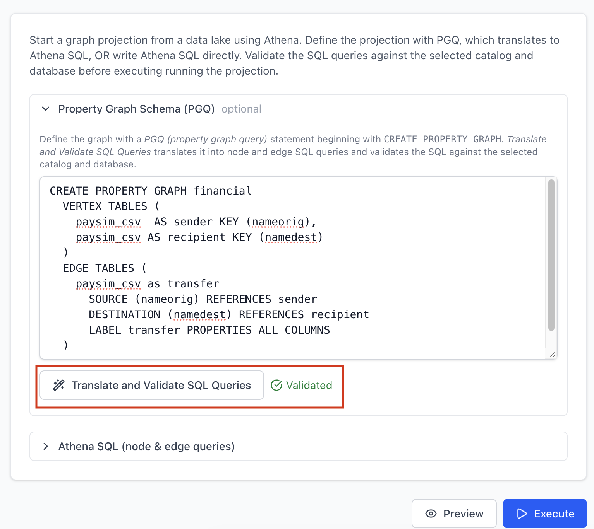

Your data lake already holds the relationships: who paid whom, which product was
bought with which. nx-neptune projects those tables into
[Amazon Neptune Analytics](https://docs.aws.amazon.com/neptune-analytics/latest/userguide/what-is-neptune-analytics.html)
so you can run graph algorithms on them. Until now, that meant writing the
projection queries using SQL. In 0.9, we added the option to declare the graph properties instead using the Property Graph Query Language (PGQL) and map it to SQL for you.  

## Before: hand-written projection queries in SQL

Neptune Analytics loads vertices and edges from CSV with special columns: `~id`
and `~label` for vertices, `~from`, `~to` and `~label` for edges, and a type
suffix on each property. To project a table of accounts and a table of
transactions, you wrote one Athena query per vertex and edge type:

```sql
-- customers
SELECT DISTINCT "name" AS "~id", 'customer' AS "~label", "name" AS "name"
FROM "accounts" WHERE "name" IS NOT NULL;

-- transfers, keeping only edges between known customers
SELECT "nameOrig" AS "~from", "nameDest" AS "~to", 'transfer' AS "~label",
       "step" AS "step:Int", CAST("amount" AS DOUBLE) AS "amount:Double",
       "isFraud" AS "isFraud:Int"
FROM "transactions"
JOIN (SELECT DISTINCT "name" AS "~key" FROM "accounts") "~source"
  ON "nameOrig" = "~source"."~key"
JOIN (SELECT DISTINCT "name" AS "~key" FROM "accounts") "~destination"
  ON "nameDest" = "~destination"."~key";
```

That works, but it's easy to get wrong, and the shape of the graph is hidden
inside the aliases.

## After: CREATE PROPERTY GRAPH

nx-neptune 0.9 accepts the standard SQL/PGQ (SQL:2023) `CREATE PROPERTY GRAPH`
statement. This is the same graph:

```sql
CREATE PROPERTY GRAPH financial
  VERTEX TABLES (
    accounts AS customer KEY (name) LABEL customer PROPERTIES (name)
  )
  EDGE TABLES (
    transactions
      SOURCE KEY (nameOrig) REFERENCES customer
      DESTINATION KEY (nameDest) REFERENCES customer
      LABEL transfer
      PROPERTIES (step, CAST(amount AS DOUBLE) AS amount, isFraud)
  )
```

nx-neptune translates it into the queries above, then runs the same import as
before: **CREATE PROPERTY GRAPH → Athena SQL → CSV in Amazon S3 → Neptune
Analytics graph**.

The translator handles the details for you:

- **Types come from the catalog.** Each property's type is read from the source
  column in the Athena catalog. `CAST` overrides it, and a type clash between
  tables that share a label fails with the `CAST` that fixes it.
- **Properties are flexible.** Leaving out `PROPERTIES` exposes all columns, as
  in the standard, and `PROPERTIES ALL COLUMNS EXCEPT (...)` drops a few.
- **Edges stay consistent.** Each edge endpoint is joined to the keys of the
  vertex table it `REFERENCES`, so only edges between declared vertices are
  loaded.

For the full syntax, property types and required permissions, see
[Property graph schema](/nx-neptune/data-lake/property-graph-schema/).

## Use it from Python

Import straight from the DDL:

```python
from nx_neptune import SessionManager

session = SessionManager("fraud-demo")
graph = await session.get_or_create_graph()
await session.import_from_graph_schema(
    graph, s3_location, DDL, catalog=catalog, database=database
)
```

Or look at the generated SQL first, without importing:

```python
from nx_neptune import AthenaTableMetadata, property_graph_to_sql

queries = property_graph_to_sql(
    DDL, AthenaTableMetadata(catalog=catalog, database=database)
)
```

For a full run on the PaySim fraud dataset, see the
[PGQ notebook](https://github.com/awslabs/nx-neptune/blob/main/notebooks/create_property_graph_pgq.ipynb).

## Use it from the Proxy UI

The Proxy UI's Import page now starts from the property graph schema. Write the
`CREATE PROPERTY GRAPH` statement, choose **Translate and Validate SQL Queries**, and review or
edit the generated Athena SQL before you import.



To go from a data-lake table to a graph in Graph Explorer, follow the
[end-to-end walkthrough](/nx-neptune/proxy/walkthrough/).

## Also in 0.9

- **Proxy UI docs.** A new [setup guide](/nx-neptune/proxy/setup/) and
  [walkthrough](/nx-neptune/proxy/walkthrough/) cover running the proxy and
  Graph Explorer locally, with finch or Docker.
- **Project export and import.** Save a project's configuration as JSON and
  import it elsewhere, to share a setup or back it up.

## Get started

```bash
pip install --upgrade nx-neptune
```

- [Documentation](https://awslabs.github.io/nx-neptune/)
- [PGQ notebook](https://github.com/awslabs/nx-neptune/blob/main/notebooks/create_property_graph_pgq.ipynb)
- [Release notes](https://github.com/awslabs/nx-neptune/releases)

Questions or ideas? Open an [issue](https://github.com/awslabs/nx-neptune/issues).
We'd love to hear how you use it.
