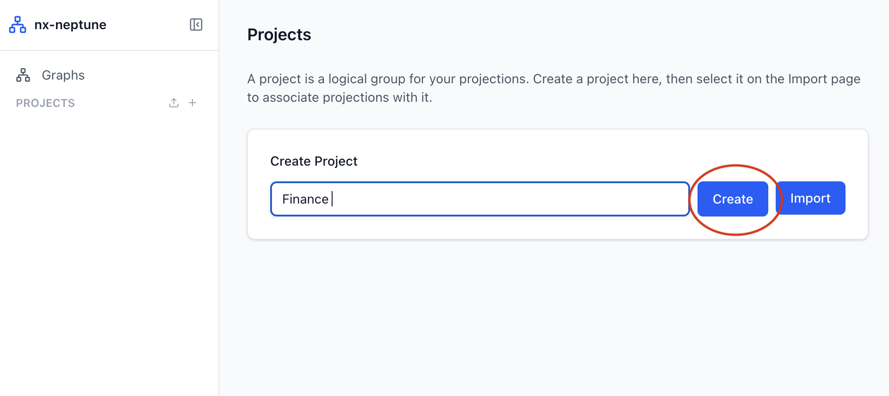
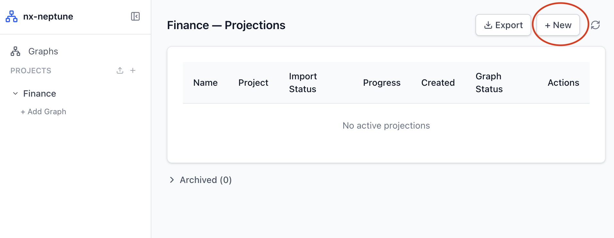
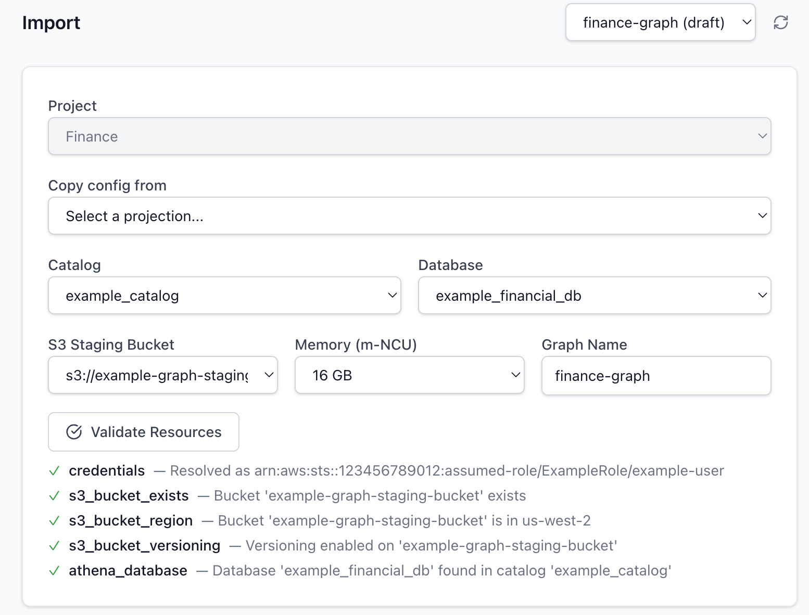
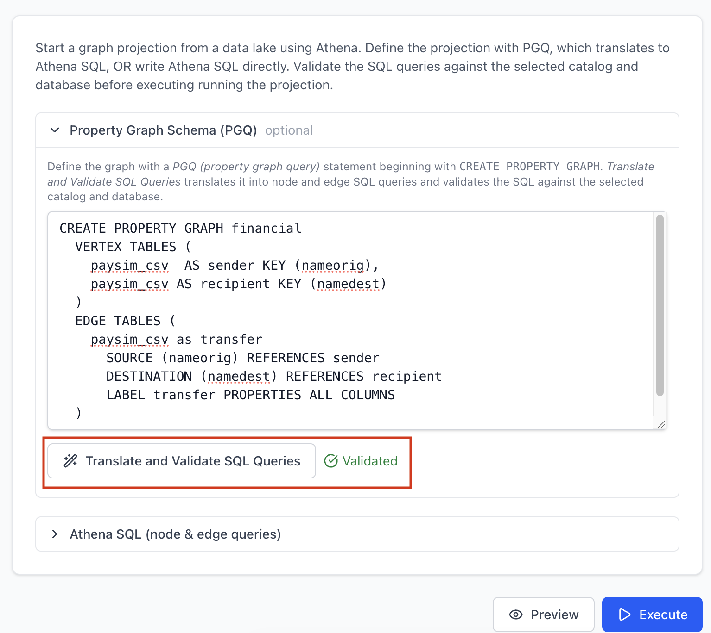
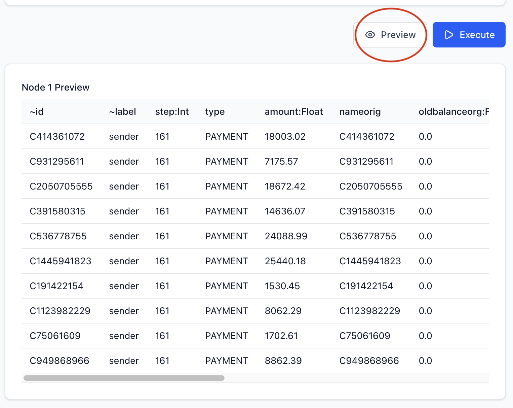
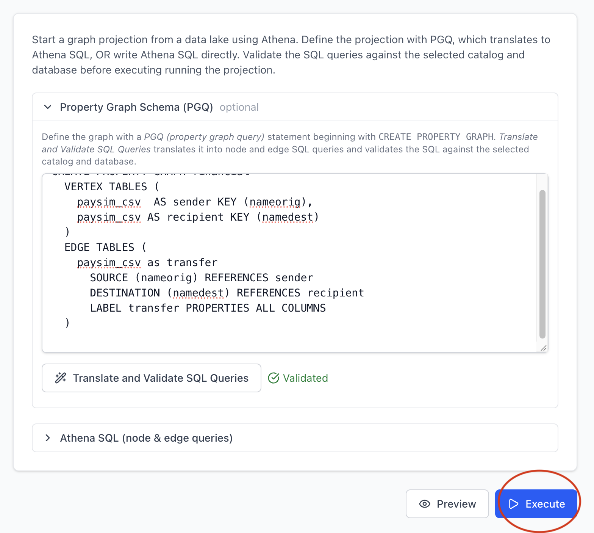
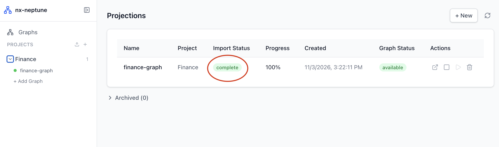
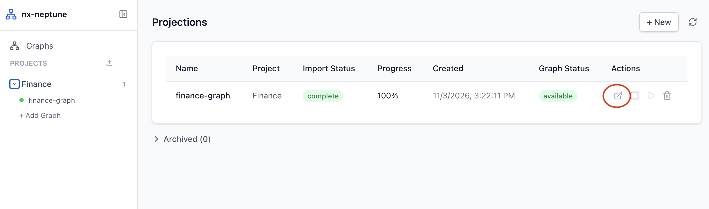

import { Aside, Steps } from '@astrojs/starlight/components';

This walkthrough takes a table in your data lake into a Neptune Analytics graph with the proxy UI, then opens the graph in Graph Explorer. It assumes the proxy is running and you have opened the launch URL (see [Proxy UI Setup](/nx-neptune/proxy/setup/)).

The examples use `paysim_csv`, a table of synthetic financial transactions from the [PaySim](https://www.kaggle.com/datasets/ealaxi/paysim1) dataset. Each row is a transfer from the account in `nameorig` to the account in `namedest`, with columns such as `step`, `type`, `amount` and `isfraud`. Use any table you can query with Athena.

<Steps>

1. **Create a project**

   A project groups the graphs you build for one piece of work. In the sidebar, choose **Add Project**, enter a project name, and choose **Create**.

   


2. **Add a graph**

   Under your project in the sidebar, choose **+ Add Graph**. This opens the **Import** page for a new projection.

   

   Choose the Athena **Catalog** and **Database** that contain your table, an **S3 Staging Bucket** for the exported data, the graph **Memory (m-NCU)**, and a **Graph Name**. Choose **Validate Resources** to check that the proxy can reach them with your credentials.

   

3. **Define the graph**

   Define the nodes and edges in one of two ways:

   - **Property Graph Schema (PGQ)**: write a `CREATE PROPERTY GRAPH` statement and choose **Translate and Validate SQL Queries**. The proxy translates it into node and edge queries and validates them against the selected catalog and database. See [Property Graph Schema](/nx-neptune/data-lake/property-graph-schema/) for the syntax.

     ```sql
     CREATE PROPERTY GRAPH financial
       VERTEX TABLES (
         paysim_csv AS sender KEY (nameorig),
         paysim_csv AS recipient KEY (namedest)
       )
       EDGE TABLES (
         paysim_csv AS transfer
           SOURCE (nameorig) REFERENCES sender
           DESTINATION (namedest) REFERENCES recipient
           LABEL transfer PROPERTIES ALL COLUMNS
       )
     ```

     Each vertex table gets its label from its alias (`sender` and `recipient`), and with no `PROPERTIES` clause it keeps all columns as properties. `PROPERTIES ALL COLUMNS` does the same for the `transfer` edges.

   - **Athena SQL (node & edge queries)**: write the node and edge queries yourself, using the Neptune load columns (`~id` and `~label` for nodes; `~from`, `~to` and `~label` for edges), then choose **Validate SQL Queries**.

   

4. **Preview the data**

   Choose **Preview** to see the first rows each node and edge query returns, and check that the ids, labels and properties look right before importing.

   

5. **Run the import**

   Choose **Execute**. The proxy creates the Neptune Analytics graph, runs the queries in Athena, stages the results in S3, and imports them into the graph. Follow the **Import Status** and **Progress** columns on the projections page for your project. Creating the graph takes several minutes.

   

6. **Check the graph**

   When the import completes, open **Graphs** in the sidebar to see the graph with its node and edge counts. The page shows the graphs that use the proxy's name prefix (`nxp-` by default). From here you can stop, start or delete the graph.

   

7. **Open the graph in Graph Explorer**

   Start Graph Explorer if it isn't running, as described in [Start Graph Explorer](/nx-neptune/proxy/setup/#start-graph-explorer).

   Back in the proxy UI, choose **Open in Graph Explorer** on the graph. It's available once the graph status is `AVAILABLE`. Graph Explorer opens on `https://localhost` (or on the port you set with `GE_PORT`) with a connection to the graph filled in, using openCypher with IAM authentication. If the link shows a connection error, check that Graph Explorer is reachable with `curl -k https://localhost:<GE_PORT>/explorer/`, and that its port isn't used by another process.

   <Aside type="note">
     Graph Explorer uses a self-signed certificate on `https://localhost`, so your browser shows a warning the first time. Accept it to continue.
   </Aside>

   

   Run an openCypher query to explore the graph, for example the transfers marked as fraud:

   ```cypher
   MATCH (a:sender)-[t:transfer]->(b:recipient)
   WHERE t.isfraud = 1
   RETURN a, t, b
   LIMIT 50
   ```

8. **Clean up**

   When you're done, delete the graph so it stops incurring cost: choose **Delete graph** on the **Graphs** page, or **Delete graph (archive projection)** on the projections page, which keeps the projection's configuration in the archived list. Then stop Graph Explorer with `make down`.

</Steps>

<Aside type="tip">
  To reuse a projection's settings and queries for another graph, choose **+ Add Graph** and pick it in **Copy config from**. To share a project, export it as JSON from the projections page, and import it from the sidebar.
</Aside>
